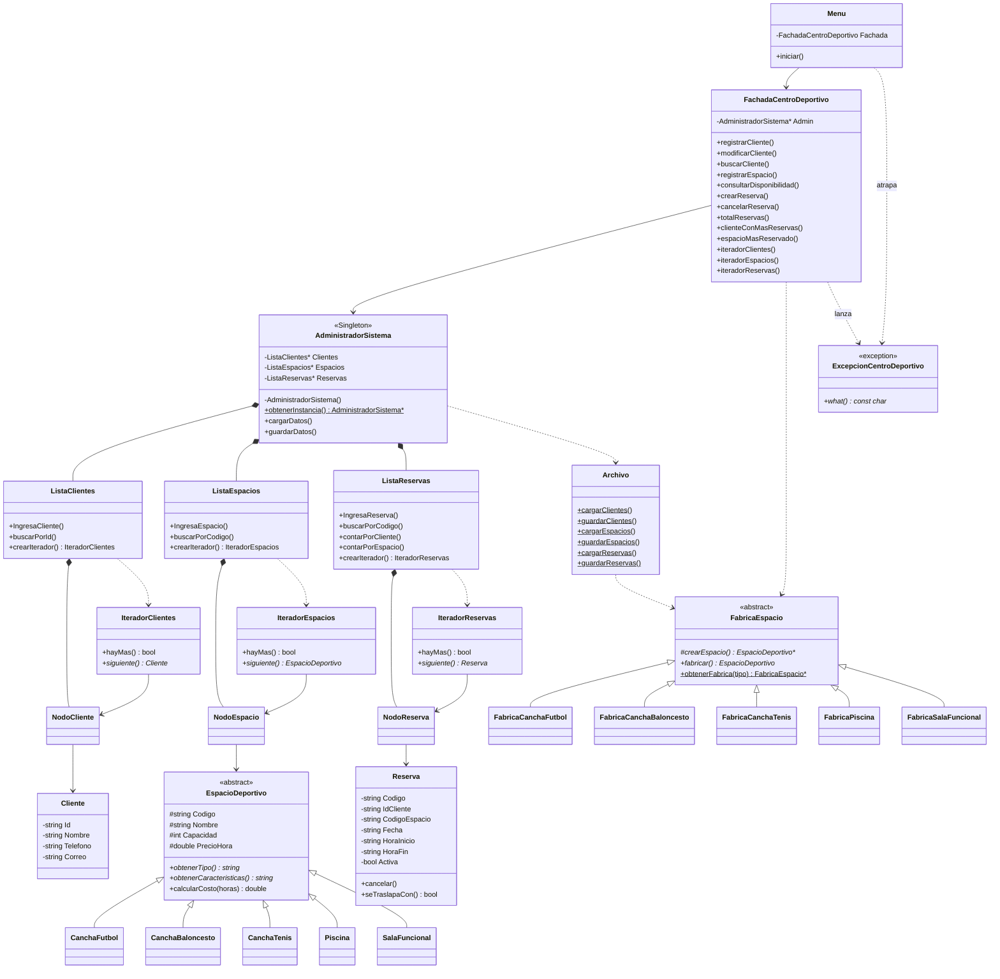
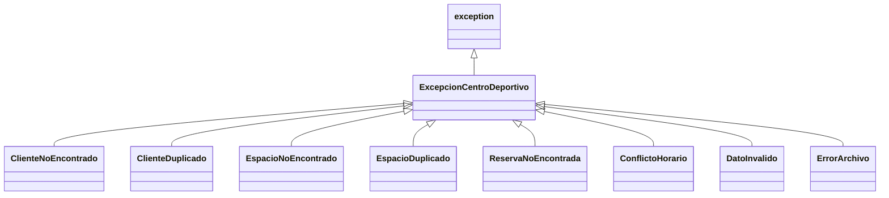

# Documento técnico: Sistema de Gestión de Reservas para un Centro Deportivo Multiuso

Proyecto de Programación II, Universidad Nacional, Sede Benjamín Núñez, 2026.

## 1. Descripción general

Aplicación de consola en C++ (estándar C++14) para gestionar clientes, espacios deportivos y reservas de un centro deportivo. Los datos se guardan en tres archivos CSV (`datos/clientes.csv`, `datos/espacios.csv`, `datos/reservas.csv`), que vienen precargados con al menos 10 registros cada uno.

Toda la interacción con el usuario la hace la clase `Menu`. Las demás clases no leen del teclado ni imprimen en pantalla. Cuando algo falla, lanzan una excepción propia y `Menu` muestra su mensaje.

## 2. Estructura del proyecto

```
Proyecto/
├── main.cpp
├── CMakeLists.txt
├── datos/          clientes.csv, espacios.csv, reservas.csv
├── docs/           documento_tecnico.md
├── Cliente/        Cliente, NodoCliente, ListaClientes, IteradorClientes
├── Espacio/        EspacioDeportivo (abstracta) y sus 5 subclases,
│   │               NodoEspacio, ListaEspacios, IteradorEspacios
│   └── Fabrica/    FabricaEspacio (abstracta) y 5 fábricas concretas
├── Reserva/        Reserva, NodoReserva, ListaReservas, IteradorReservas
├── Archivo/        Archivo (lectura y escritura de CSV)
├── Excepciones/    ExcepcionCentroDeportivo y 8 excepciones derivadas
├── Sistema/        AdministradorSistema (Singleton), FachadaCentroDeportivo (Facade)
└── Menu/           Menu
```

Cada clase tiene su propio par `.h`/`.cpp`. Los `#include` usan la ruta desde la raíz del proyecto (por ejemplo `#include "Cliente/ListaClientes.h"`), gracias a `target_include_directories(Proyecto PRIVATE ${CMAKE_SOURCE_DIR})`.

## 3. Diagrama de clases



Jerarquía de excepciones (todas heredan de `ExcepcionCentroDeportivo`, que hereda de `std::exception`):



## 4. Patrones de diseño implementados

### 4.1 Singleton: `AdministradorSistema`

**Dónde:** `Sistema/AdministradorSistema.h/.cpp`.

**Cómo:** el constructor es privado, y el constructor de copia y el operador de asignación están eliminados (`= delete`). La única forma de obtener el objeto es `AdministradorSistema::obtenerInstancia()`, que declara una variable `static` local: se crea la primera vez que se llama al método y se destruye automáticamente al terminar el programa.

```cpp
AdministradorSistema* AdministradorSistema::obtenerInstancia() {
    static AdministradorSistema instancia;
    return &instancia;
}
```

**Por qué:** el administrador es dueño de las listas de clientes, espacios y reservas y conoce las rutas de los archivos. Tiene que haber uno solo para que todo el programa trabaje sobre los mismos datos. El Singleton lo garantiza sin recurrir a variables globales, que el enunciado prohíbe.

### 4.2 Iterator: `IteradorClientes`, `IteradorEspacios`, `IteradorReservas`

**Dónde:** `Cliente/IteradorClientes`, `Espacio/IteradorEspacios`, `Reserva/IteradorReservas`.

**Cómo:** cada lista (el *agregado*) ofrece `crearIterador()`, que devuelve un iterador posicionado en el primer nodo. El iterador tiene dos operaciones: `hayMas()` y `siguiente()`, que devuelve el elemento actual y avanza. Las listas no tienen `getPrimero()`, así que los nodos nunca salen de ellas.

```cpp
IteradorClientes it = Fachada.iteradorClientes();
while (it.hayMas()) {
    cout << it.siguiente()->toString() << endl;
}
```

**Por qué:** el enunciado exige que el menú no recorra las estructuras directamente. Con el iterador, `Menu`, `Archivo` y la fachada recorren las colecciones sin conocer cómo están implementadas (lista enlazada con nodos). Si mañana la lista cambia, quien la recorre no cambia.

### 4.3 Facade: `FachadaCentroDeportivo`

**Dónde:** `Sistema/FachadaCentroDeportivo.h/.cpp`.

**Cómo:** ofrece una operación por cada caso de uso: `registrarCliente`, `modificarCliente`, `buscarCliente`, `registrarEspacio`, `buscarEspacio`, `consultarDisponibilidad`, `crearReserva`, `consultarReserva`, `cancelarReserva`, los reportes y `cargarDatos`/`guardarDatos`. Por dentro coordina el administrador, las listas, las fábricas y los archivos, valida las reglas de negocio (campos sin comas, correo con `@`, formato de fecha y hora, choques de horario, duplicados) y lanza la excepción que corresponda.

**Por qué:** `Menu` solo conoce a la fachada. Para crear una reserva el menú no tiene que buscar el cliente, buscar el espacio, revisar los traslapes, generar el código e insertar en la lista: llama a `crearReserva(...)` y atrapa la excepción si algo sale mal. Así se separa la interfaz de usuario de la lógica.

### 4.4 Patrón adicional: Factory Method, `FabricaEspacio`

**Dónde:** `Espacio/Fabrica/`.

**Cómo:** `FabricaEspacio` es el *creador abstracto*. Su método público `fabricar(...)` valida los datos (código y nombre no vacíos, capacidad y precio mayores que cero) y luego llama al *método fábrica* `crearEspacio(...)`, que es virtual puro. Cada *creador concreto* (`FabricaCanchaFutbol`, `FabricaCanchaBaloncesto`, `FabricaCanchaTenis`, `FabricaPiscina`, `FabricaSalaFuncional`) implementa `crearEspacio` devolviendo su producto concreto. El método estático `obtenerFabrica(tipo)` elige el creador concreto a partir del texto del tipo.

```cpp
FabricaEspacio *fabrica = FabricaEspacio::obtenerFabrica(tipo);
EspacioDeportivo *espacio = fabrica->fabricar(codigo, nombre, capacidad, precioHora);
delete fabrica;
```

**Por qué:** los espacios se crean en dos lugares: al leer `espacios.csv` (`Archivo`) y al registrar uno desde el menú (fachada). Ninguno de los dos hace `new` de una clase concreta ni repite las validaciones. Para agregar un tipo de espacio nuevo basta con crear la subclase y su fábrica y registrarla en `obtenerFabrica`; el resto del código trabaja con `EspacioDeportivo*`.

### 4.5 Manejo de excepciones (puntos extra)

Las clases de lógica lanzan (`throw`) excepciones propias de la jerarquía `ExcepcionCentroDeportivo`. `Menu` envuelve cada operación en `try { ... } catch (ExcepcionCentroDeportivo &e)` y muestra `e.what()`. `Archivo` también atrapa `DatoInvalido` internamente para omitir las líneas inválidas de `espacios.csv` sin detener la carga.

## 5. Responsabilidades de las clases

| Clase | Carpeta | Responsabilidad |
|---|---|---|
| `Menu` | `Menu/` | Única clase que interactúa con el usuario: muestra menús, lee entradas, muestra resultados y mensajes de error. |
| `FachadaCentroDeportivo` | `Sistema/` | Facade. Expone los casos de uso, valida reglas de negocio, calcula reportes y entrega iteradores. |
| `AdministradorSistema` | `Sistema/` | Singleton. Dueño de las tres listas; carga y guarda los datos mediante `Archivo`. |
| `Archivo` | `Archivo/` | Lee y escribe los CSV. Omite líneas inválidas o duplicadas. Lanza `ErrorArchivo` si un archivo no abre. |
| `Cliente` | `Cliente/` | Datos de un cliente: identificación, nombre, teléfono, correo. |
| `NodoCliente` | `Cliente/` | Nodo de la lista enlazada de clientes. |
| `ListaClientes` | `Cliente/` | Lista enlazada de clientes: insertar, buscar por id, vaciar, crear iterador. |
| `IteradorClientes` | `Cliente/` | Recorre `ListaClientes` sin exponer sus nodos. |
| `EspacioDeportivo` | `Espacio/` | Clase abstracta: datos comunes de un espacio y cálculo del costo por horas. |
| `CanchaFutbol`, `CanchaBaloncesto`, `CanchaTenis`, `Piscina`, `SalaFuncional` | `Espacio/` | Tipos concretos de espacio; implementan `obtenerTipo()` y `obtenerCaracteristicas()`. |
| `NodoEspacio`, `ListaEspacios`, `IteradorEspacios` | `Espacio/` | Lista enlazada de espacios y su iterador. |
| `FabricaEspacio` | `Espacio/Fabrica/` | Creador abstracto del Factory Method; valida y delega la creación. |
| `FabricaCanchaFutbol`, ..., `FabricaSalaFuncional` | `Espacio/Fabrica/` | Creadores concretos; cada uno crea su tipo de espacio. |
| `Reserva` | `Reserva/` | Datos de una reserva, estado activa/cancelada, duración, detección de traslapes y validación de fecha y hora. |
| `NodoReserva`, `ListaReservas`, `IteradorReservas` | `Reserva/` | Lista enlazada de reservas (con conteos para reportes) y su iterador. |
| `ExcepcionCentroDeportivo` y derivadas | `Excepciones/` | Representan cada tipo de error con su mensaje. |

## 6. Reglas de negocio

- **Identificación de cliente y código de espacio** únicos.
- **Campos de texto** no vacíos y sin comas (se guardan en CSV). El correo debe contener `@`.
- **Fecha** en formato `AAAA-MM-DD` (se valida que el día exista, incluido el 29 de febrero en años bisiestos). **Horas** en formato `HH:MM`; la de inicio debe ser anterior a la de fin.
- **Conflicto de horario:** no se puede reservar un espacio si ya tiene una reserva activa ese mismo día cuyo rango se traslape. Los rangos son `[inicio, fin)`: una reserva que termina a las 19:00 no choca con otra que empieza a las 19:00.
- **Cancelar** una reserva no la borra: queda en estado `Cancelada` y sigue contando como reserva realizada en los reportes. No se puede cancelar dos veces.
- **Espacio ocupado:** tiene al menos una reserva activa. **Disponible:** no tiene ninguna.
- **Código de reserva:** se genera como `R` + el número siguiente al mayor existente (`R016`, `R017`, ...).
- **Costo de una reserva:** precio por hora del espacio × duración en horas.

## 7. Persistencia

| Archivo | Encabezado |
|---|---|
| `clientes.csv` | `id,nombre,telefono,correo` |
| `espacios.csv` | `codigo,tipo,nombre,capacidad,precioHora` |
| `reservas.csv` | `codigo,idCliente,codigoEspacio,fecha,horaInicio,horaFin,estado` |

Los datos se cargan al iniciar el programa y se pueden recargar (opción 6) o guardar (opción 5) desde el menú principal. Al salir, el programa pregunta si se desean guardar los cambios.

El programa abre los archivos con la ruta relativa `datos/<archivo>.csv`. El `CMakeLists.txt` copia la carpeta `datos/` dentro de la carpeta del build con `configure_file`, así que:

- **Desde CLion** (la carpeta de trabajo es la del build) se usa la copia del build, y lo que se guarde queda en esa copia.
- **Por consola** funciona ejecutando desde la raíz del proyecto (usa `datos/` original) o desde la carpeta del build.

Nota: al reconfigurar CMake, si un CSV de `datos/` cambió, su copia en el build se reemplaza por el original.

## 8. Capturas de ejecución

> Agregar aquí las capturas de pantalla de la ejecución.

1. Menú principal y carga inicial de datos.
2. Gestión de clientes: registrar, modificar, listar, buscar.
3. Gestión de espacios: disponibles, ocupados, búsqueda, disponibilidad por horario.
4. Gestión de reservas: crear (incluyendo un conflicto de horario), consultar, cancelar, listar activas.
5. Reportes.
6. Manejo de errores (cliente inexistente, fecha inválida, etc.).
